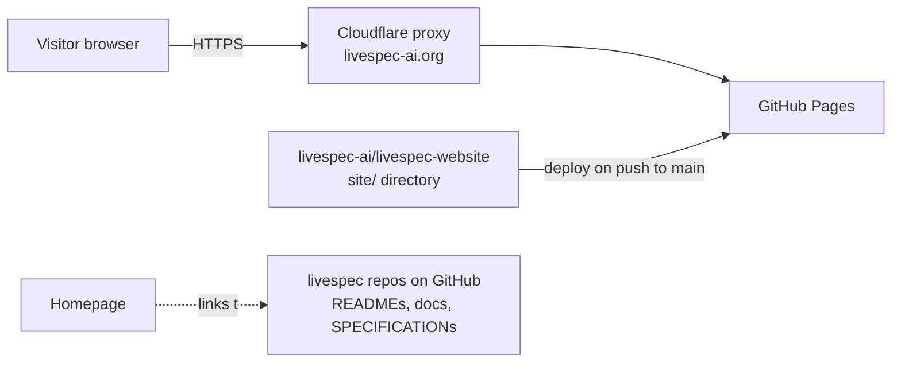

# livespec-ai.org — the livespec project website

## Project intent

`livespec-ai.org` is a minimal, pure-HTML public website for the
livespec project, authored by Chad Woolley ("thewoolleyman"). It
explains what livespec is, states the project's goals, summarizes
the project's current high-level state by linking out to the
livespec repositories, introduces the author, and hosts a blog
chronicling the author's journey exploring those goals.

livespec is presented as a **"dark" software factory** and an
**experimental work in progress** pursuing three goals:

1. **A circular feedback loop between specification and
   implementation** — the specification drives the implementation,
   and observations of the implementation feed back into the
   specification through governed revision.
2. **Turning every quality dial as close to 11 as possible** within
   cost and speed constraints — an explicit engagement with the
   "fast, cheap, right: pick two" triangle.
3. **Finding the minimal human attention** the factory needs to
   still produce usable, high-quality implementations — interfacing
   only with AI surfaces, rarely if ever directly reviewing code or
   specification, reviewing only the delivered implementation, and
   relying on observability signals across every aspect of the
   factory and the implementation for guidance.

## Architecture

The site is a set of hand-authored static HTML pages plus one
shared stylesheet, served by GitHub Pages behind Cloudflare. There
is no build step, no client-side framework, and no server-side
code.

### Pages

The site has exactly two content areas at launch:

- **Homepage** at `/` (see [Homepage](#homepage)).
- **Blog** at `/blog/` (see [Blog](#blog)).

### Homepage

The homepage MUST contain, in this order:

1. **What is livespec** — a short description of livespec as a
   "dark" software factory and an experimental work in progress,
   linking to the author's article "The Software Factory: A
   Practitioner's Guide" at
   `https://thewoolleyweb.com/software-factory-practitioners-guide.html`.
2. **Blog link** — a link to `/blog/`.
3. **Goals** — the three goals named in
   [Project intent](#project-intent), in that order, each explained
   in no more than a short paragraph. The quality-dials goal MUST
   name the fast/cheap/right "pick two" triangle. The
   minimal-human-attention goal MUST list its four practices
   (AI surfaces only, rarely reviewing code or specification,
   reviewing only the delivered implementation, relying on
   observability signals) as a bulleted sub-list.
4. **Project state** — a high-level summary of where livespec
   currently stands. This section MUST rely primarily on links to
   existing content in the livespec GitHub repositories (READMEs,
   `docs/`, and `SPECIFICATION/` trees) and MUST NOT duplicate that
   content beyond a sentence or two of framing per link. At minimum
   it MUST link to the core `thewoolleyman/livespec` repository's
   README, its installation documentation, and its `SPECIFICATION/`
   tree.
5. **Author** — headed "Who is responsible for this?": the
   author's professional bio introducing Chad Woolley
   ("thewoolleyman"), with links to `https://thewoolleyweb.com/`
   and `https://github.com/thewoolleyman`.

### Blog

The blog lives under `/blog/`:

- `/blog/` is an index page listing every published entry, newest
  first, each with its title (linked), publication date, and an
  optional one-sentence summary.
- Each entry lives at `/blog/<slug>/`, where `<slug>` is a
  lowercase, hyphen-separated identifier that never changes after
  publication.
- Each entry page MUST present an article header containing the
  entry title, an author byline ("Chad Woolley", linking to
  `https://thewoolleyweb.com/`), and the publication date,
  followed by the body prose, and MUST link back to `/blog/` and
  `/`.
- At launch the blog contains exactly two entries, each a clearly
  marked **placeholder** with a humorous Industrial-Revolution-themed
  title and an Industrial-Revolution-era publication date, so the
  blog index and article layout can be reviewed with realistic
  content. Each index summary MUST read "Placeholder for the first
  entry." or "Placeholder for the second entry." Each placeholder
  body MUST be several paragraphs of humorous AI-slop-themed
  lorem-ipsum-style filler text until the author writes the real
  content. The first entry keeps its original slug,
  `the-journey-begins`.

The blog's subject is the author's journey exploring the
project goals.

### Visual style

The visual style derives from thewoolleyweb.com's "takahashi"
stylesheet (`default.css` in `thewoolleyman/thewoolleyman`): big
letters, greyscale only, black header band, grey content area,
bold link-heavy navigation headings.

- Navigation and heading content (site title, section headings,
  link lists) uses the takahashi look: large, bold, centered,
  except as the article style below specifies.
- Prose content (homepage paragraphs, blog entry bodies) uses a
  **prose style** added for this site: start-aligned (left-aligned
  in English), normal font weight, comfortable line height, and
  constrained to a readable line length.
- Blog entry pages use an **article style** added for this site:
  the title, byline, and body share one readable column; the title
  is large and bold but start-aligned with the body rather than set
  in a centered band; the byline is visually subordinate to the
  title; body text follows modern long-form reading conventions.

The normative palette, font, and prose-measure rules live in
[constraints.md](constraints.md#styling).

## Definition of Done

A livespec-website change MUST satisfy both parts of this DoD.

Before merge:

- The spec change MUST flow through the propose-change/revise
  loop, with no out-of-band edits.
- Every page MUST conform to [contracts.md](contracts.md) and
  [constraints.md](constraints.md).
- The site-wide link check MUST pass (see
  [non-functional-requirements.md](non-functional-requirements.md)).
- The doctor static phase MUST pass against the working spec.

After merge:

- The change MUST be verified live on `https://livespec-ai.org/`
  per [non-functional-requirements.md](non-functional-requirements.md#contributor-workflow).
  A change is not done until that verification succeeds.

## Non-goals

- No JavaScript framework, bundler, transpiler, or static-site
  generator.
- No user accounts, comments, search, or server-side code.
- No duplication of livespec documentation already maintained in
  the livespec repositories.
- No color theme or dark mode at launch.
