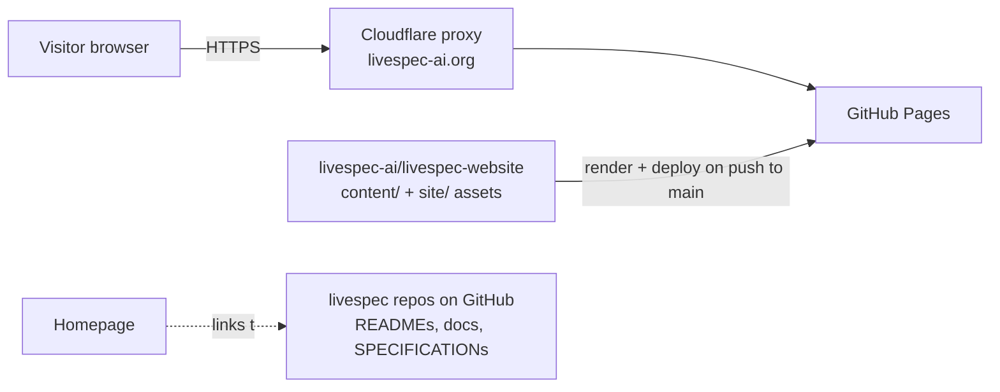

# livespec-ai.org — the livespec project website

## Project intent

`livespec-ai.org` is a minimal, pure-HTML public website for the
livespec project, authored by Chad Woolley ("thewoolleyman"). It
explains what livespec is, states the project's goals, summarizes
the project's current high-level state by linking out to the
livespec repositories, introduces the author, and hosts a blog
chronicling the author's journey exploring those goals.

livespec is presented as a **"dark" software factory** and an
**experimental work in progress** pursuing three goals:

1. **A circular feedback loop between specification and
   implementation** — the specification drives the implementation,
   and observations of the implementation feed back into the
   specification through governed revision.
2. **Turning every quality dial as close to 11 as possible** within
   cost and speed constraints — an explicit engagement with the
   "fast, cheap, right: pick two" triangle.
3. **Finding the minimal human attention** the factory needs to
   still produce usable, high-quality implementations.

## Architecture

The site is a set of static HTML pages plus one shared
stylesheet, served by GitHub Pages behind Cloudflare. Each page is
authored as Markdown and rendered to HTML with pandoc through one
shared page template. The deploy workflow renders the pages from
the Markdown sources on every push to `main`, and the rendered HTML
under `site/` is what visitors receive; it is a build output and
MUST NOT be committed. There is no client-side framework and no
server-side code.

### Pages

The site has exactly two content areas at launch:

- **Homepage** at `/` (see [Homepage](#homepage)).
- **Blog** at `/blog/` (see [Blog](#blog)).

### Homepage

The homepage MUST contain:

- a description of what livespec is;
- a link to `/blog/`;
- the project goals named in [Project intent](#project-intent);
- links to the livespec GitHub repositories, including at minimum
  the core `thewoolleyman/livespec` repository's README, its
  installation documentation, and its `SPECIFICATION/` tree;
- an introduction to the author, Chad Woolley ("thewoolleyman"),
  with links to `https://thewoolleyweb.com/` and
  `https://github.com/thewoolleyman`.

The wording, order, headings, and any additional content are the
author's editorial choice.

### Blog

The blog lives under `/blog/`:

- `/blog/` is an index page listing every published entry, newest
  first, each with its title (linked), publication date, and an
  optional one-sentence summary.
- Each entry lives at `/blog/<slug>/`, where `<slug>` is a
  lowercase, hyphen-separated identifier that never changes after
  publication.
- Each entry page MUST present an article header containing the
  entry title, an author byline ("Chad Woolley", linking to
  `https://thewoolleyweb.com/`), and the publication date,
  followed by the body prose, and MUST link back to `/blog/` and
  `/`.
- Until the author writes real entries, the blog MAY contain
  placeholder entries; each placeholder MUST be clearly marked as a
  placeholder. Entry titles, dates, and body content are the
  author's editorial choice.

The blog's subject is the author's journey exploring the
project goals.

### Visual style

The visual style derives from thewoolleyweb.com's "takahashi"
stylesheet (`default.css` in `thewoolleyman/thewoolleyman`): big
letters, greyscale only, black header band, grey content area,
bold link-heavy navigation headings.

- Navigation and heading content (site title, section headings,
  link lists) uses the takahashi look: large, bold, centered,
  except as the article style below specifies.
- Prose content (homepage paragraphs, blog entry bodies) uses a
  **prose style** added for this site: start-aligned (left-aligned
  in English), normal font weight, comfortable line height, and
  constrained to a readable line length.
- Blog entry pages use an **article style** added for this site:
  the title, byline, and body share one readable column; the title
  is large and bold but start-aligned with the body rather than set
  in a centered band; the byline is visually subordinate to the
  title; body text follows modern long-form reading conventions.

The normative palette, font, and prose-measure rules live in
[constraints.md](constraints.md#styling).

## Definition of Done

A livespec-website change MUST satisfy both parts of this DoD.

Before merge:

- The spec change MUST flow through the propose-change/revise
  loop, with no out-of-band edits.
- Every page MUST conform to [contracts.md](contracts.md) and
  [constraints.md](constraints.md).
- The site-wide link check MUST pass (see
  [non-functional-requirements.md](non-functional-requirements.md)).
- The doctor static phase MUST pass against the working spec.

After merge:

- The change MUST be verified live on `https://livespec-ai.org/`
  per [non-functional-requirements.md](non-functional-requirements.md#contributor-workflow).
  A change is not done until that verification succeeds.

## Non-goals

- No JavaScript framework, bundler, or transpiler, and no
  static-site generator beyond pandoc rendering each Markdown page
  through the one shared page template, run by the deploy workflow
  and on contributor machines for local preview.
- No user accounts, comments, search, or server-side code.
- No duplication of livespec documentation already maintained in
  the livespec repositories.
- No color theme or dark mode at launch.
